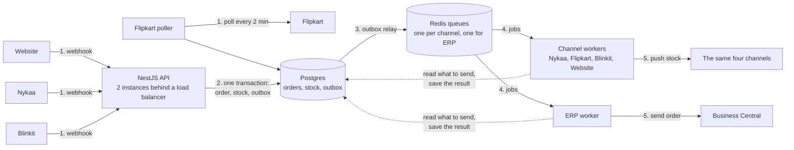

# Order & Inventory Sync Service: Design

This is a NestJS codebase running on EC2. All the important data about orders and inventory lives in PostgreSQL. Redis-backed background workers handle the follow-up jobs, such as sending an order to the ERP and pushing stock to a channel. Every stock change is written in one SQL transaction together with its inventory movement row, and every channel gets its own isolated worker, so a problem on one channel doesn't spread to the others.

Stock is tracked as two numbers per SKU, what is in the warehouse and what is already promised to orders. A promise is a reservation, and it is made the moment an order arrives. Section 4 explains how that works.

## 1. Architecture



The `api` runs on two instances behind a load balancer and also serves the ops screen. The workers and the outbox relay are separate processes started from the same code (PM2 or Docker on the same boxes). The Flipkart poller is a repeatable job in its own queue, so only one copy runs at a time. Each channel has its own queue and its own rate limiter, so a slow or failing channel only backs up its own queue.

On scaling and cost: peak is about 5 orders a second and each order is a handful of rows, so the database isn't the worry. The API sits in an auto scaling group, and I can start more copies of a worker when its queue backs up, so nobody scales by hand on a sale day. Cost is a couple of EC2 boxes, one RDS, one small Redis and a load balancer, which I expect to land well under ₹50k a month (not priced properly, I'd check the AWS calculator). I skipped SQS, Kafka and other managed pieces I couldn't justify.

## 2. Data model

| Table | Key columns | Notes |
|---|---|---|
| `sales_channels` | id, code, name, ingest_mode, max_rps, batch_size, poll_cursor, erp_customer_code, is_enabled | `UNIQUE(code)`. Seeded with WEBSITE, NYKAA, FLIPKART, BLINKIT. Workers read their rate limit and batch size from here. |
| `warehouse_inventory` | sku (PK), on_hand, reserved, safety_buffer, low_threshold, updated_at | `CHECK(reserved >= 0)`. Available stock is `on_hand - reserved`. An adjustment that would push `on_hand` below `reserved` is rejected and goes to ops. |
| `reservations` | id, sales_channel_id, external_ref, order_id, sku, qty, status, expires_at, created_at | `UNIQUE(sales_channel_id, external_ref, sku)`. `external_ref` is the order id for marketplaces and the checkout id for website holds. Status is HELD, CONFIRMED, FULFILLED, RELEASED or EXPIRED. |
| `orders` | id (uuid), sales_channel_id, external_order_id, status, last_event_time, total_amount, payment_mode, shipping_pincode | `UNIQUE(sales_channel_id, external_order_id)`. Status is CONFIRMED, OVERSOLD, CANCELLED or RETURNED. |
| `order_items` | order_id, sku, qty, unit_price | PK(order_id, sku), `qty > 0`. |
| `inventory_movements` | id, sku, delta_on_hand, delta_reserved, on_hand_after, reserved_after, reason, reservation_id, actor, created_at | Append-only. Reason is RESERVE, RELEASE, EXPIRE, DISPATCH, RETURN or ADJUSTMENT. `UNIQUE(reason, reservation_id)` where `reservation_id` is not null. |
| `sales_channel_events` | id, sales_channel_id, external_order_id, event_type, event_time, raw_payload, processed_at | `UNIQUE(sales_channel_id, external_order_id, event_type)`. This is what stops duplicate webhooks. |
| `channel_inventory` | sales_channel_id, sku, desired_quantity, last_synced_quantity, last_synced_at | PK(sales_channel_id, sku). A row needs a push when the two quantities differ. |
| `outbox_events` | id, order_id (null for stock syncs), event_type, details (json), status, last_attempt, next_attempt | Event type is ERP_DELIVERY_REQUIRED or STOCK_SYNC_REQUIRED. Status is pending, in_progress, finished or failed. |
| `erp_deliveries` | order_id (unique), status, attempts, next_attempt_at, erp_reference | One row per order. This is what ops looks at, and it makes ERP sends idempotent. |

Duplicates are stopped in three places. The raw event has a unique key on `(sales_channel_id, external_order_id, event_type)`, so Nykaa sending an order twice does nothing the second time, while a later cancel for the same order still gets through. The order itself has a unique key on `(sales_channel_id, external_order_id)`. And the movement row's unique key means that even a replayed reservation can't move stock a second time.

For the audit question, "why did SKU X change" is `SELECT * FROM inventory_movements WHERE sku = ? ORDER BY id`. Each row says how much it moved, what it was afterwards, why, and which order or person caused it.

## 3. Order ingestion

For webhooks (website, Nykaa, Blinkit), the handler checks the signature, inserts the raw event with `ON CONFLICT DO NOTHING`, then normalises the order and reserves stock in a second transaction before returning 200. If that step fails the raw event is already saved and gets reprocessed later. The handler never calls the ERP or a channel.

Flipkart is polled. The poller stores its position in `sales_channels.poll_cursor` and re-reads the last 10 minutes each run. That overlap is safe because ingestion is idempotent, and it means a missed run catches up by itself.

For out-of-order events, a single order's events are processed one at a time (row lock on the order), and a status change only applies if it's a valid forward move and newer than `last_event_time`. If a cancel arrives before the create, I save the order as CANCELLED and don't touch stock, and the create that arrives later is ignored.

If a channel is down, only its worker is affected. I assume Nykaa and Blinkit retry failed webhooks (assumption 3), we alert when a channel goes silent during trading hours, and a daily comparison with each channel's order report catches the rest.

## 4. Inventory and reservations

`warehouse_inventory` keeps two numbers per SKU: `on_hand`, what is physically in the warehouse, and `reserved`, what we have promised to orders that haven't shipped. What we can sell is `available = on_hand - reserved`. A row in `reservations` is the promise itself, one per order line, and it is what moves `reserved`.

I split them because "in the warehouse" and "already promised" are different facts: counts, damage and returns change `on_hand`, orders change `reserved`, and neither overwrites the other. It also lets the website hold stock with an expiry. A reservation moves through these states:

- HELD: website checkout only. The customer is paying, so we hold the units for a few minutes (configurable). If no payment comes, a sweeper releases the hold and marks it EXPIRED.
- CONFIRMED: the order is real. Marketplace orders are created straight in this state because the customer has already paid. A website hold moves here when the order-created event arrives.
- FULFILLED: the ERP reports the order dispatched, and both `on_hand` and `reserved` drop by the quantity.
- RELEASED: the order was cancelled before dispatch, so `reserved` drops and the units are sellable again.

A return adds to `on_hand` only after the warehouse has received and checked the item (RETURN). A cancel that arrives after dispatch is treated as a return.

A Nykaa customer has already paid by the time we hear about the order, so we can't refuse it. That gives two jobs: make clashes unlikely, and handle the ones that still happen correctly.

**Making clashes unlikely.** Channels are told `desired_quantity = max(0, available - safety_buffer)`. The buffer covers what other channels might sell before our next push lands. My starting formula is `ceil(sales_per_min × push_latency_min × 1.5)`, recalculated hourly from recent movements, with a manual override for hot SKUs before a sale. Once `available` falls to `low_threshold`, the marketplaces are told 0 and the last few units stay with our own website. The website holds stock when checkout starts, so it can say "out of stock" before taking money and without cancelling anyone. We lose a few marketplace sales this way, which I'd accept to avoid cancellations that hurt seller ratings.

**Handling the rest.** Reserving stock for an order is one conditional update in a transaction:

```
UPDATE warehouse_inventory SET reserved = reserved + :qty
WHERE sku = :sku AND on_hand - reserved >= :qty     -- 0 rows means no stock
```

Around that statement the transaction locks the order row, skips replays, writes the reservation and ledger rows, updates `desired_quantity` for each channel and adds the outbox rows. The full step is in [docs/stock-reservation-pseudocode.md](docs/stock-reservation-pseudocode.md).

Say the last unit is sold on Nykaa and the website in the same second, so `available` is 1.
1. Both raw events are saved. They don't compete.
2. Both transactions run the conditional UPDATE on the same `warehouse_inventory` row. Postgres lets one go first. Say it's the website: it raises `reserved` and commits.
3. The Nykaa transaction was waiting on that row. When it gets the lock, Postgres re-checks the WHERE clause on the new row version and `on_hand - reserved >= 1` is now false. Zero rows updated.
4. The website order is saved with its reservation, movement row and outbox events, and `desired_quantity` is set to 0 for every channel.
5. The Nykaa order is marked OVERSOLD and no stock moves. It appears on the ops screen as an order to cancel in the seller panel, and it counts toward the oversell metric.
6. The workers push 0 to every channel, and this SKU is picked first because it's the most at risk.

Whoever commits first wins, and nothing is corrupted either way. An order with several SKUs succeeds or fails as a whole.

The website does the same conditional update when checkout starts, just with status HELD and an expiry. If the customer pays after the hold expired, the order step tries to reserve again, and if the stock is gone the order goes OVERSOLD like any other.

What reservations cost: one more table, an expiry sweeper, and a dependency on the ERP telling us about dispatches. If that signal is late, `reserved` stays too high and we under-sell, so a nightly job recomputes `reserved` from the open reservations and compares `on_hand` with the ERP's count.

## 5. Pushing stock within 60 seconds

The reserve transaction only changes `desired_quantity` and adds a STOCK_SYNC_REQUIRED outbox row. The relay copies pending rows into one Redis queue per channel. A worker doesn't trust the job's contents: it reads the rows where `desired_quantity <> last_synced_quantity`, sorts them by risk (lowest available first) then age, sends the current value, and saves `last_synced_quantity` as the value it sent. If `desired_quantity` changed during the call the two still differ, so the row is pushed again and no dirty flag or version column is needed. Pushes are absolute quantities, never deltas, so retries and duplicates do no harm. A periodic sweep re-queues any differing row, so a lost Redis can't leave a channel stale.

| Channel | Budget | What I do |
|---|---|---|
| Nykaa | 5 rps, I use 4, so 240 SKU updates a minute | Queue rate limiter at 4 per second. Coalesce, sort by risk, skip small changes when stock is high. |
| Flipkart | 10 rps, 50 SKUs per call | Take up to 50 differing rows per call. The whole catalogue is 24 calls. On a 429, follow Retry-After, halve the rate, then ramp back up. |
| Blinkit | REST for urgent changes only | Push by REST only when a SKU is about to hit zero or has come back. The daily CSV sets the full baseline and fixes drift. |
| Website | none | Direct write. |

One thing I can't fully solve: Nykaa takes only 240 updates a minute. Sale-day sales concentrate on hot SKUs, which risk ordering handles first, but if more than 240 different SKUs change in one minute the safest ones will lag. So I'd define the 60 second target for at-risk SKUs and say so up front.

## 6. When things fail

Redis jobs retry with exponential backoff and jitter, from 5 seconds up to 15 minutes. All the state that matters is in Postgres, so losing Redis or restarting a worker loses nothing: the relay re-queues any outbox row stuck in pending or in_progress for too long.

**ERP Sunday downtime.** Orders are committed together with their `erp_deliveries` row, so nothing waits on the ERP. If the ERP worker sees 5 failures in a row, it pauses its queue and checks once a minute. An unreachable ERP doesn't use up an order's attempts. When it's back, the backlog (about 700 orders after 2 hours on a normal day) is sent at a throttled rate.

**Exactly once to the ERP.** True exactly-once across two systems isn't achievable, so I do at-least-once with an idempotent receiver. We send our order id as the Business Central external document number, and before creating anything the worker looks that number up. If we crashed after the POST but before saving `erp_reference`, the lookup finds the existing document next time.

**Blinkit timeouts.** A timeout means we don't know if it worked, but pushes are absolute so retrying is safe. I retry three times quickly (1, 3 and 9 seconds), then leave the row differing for the next cycle. If an at-risk SKU fails three times, ops gets an alert to pause that listing by hand.

**Messages that keep failing.** An error that won't fix itself (a 4xx, an SKU the ERP doesn't know) or 8 failed attempts moves the row to failed. The ops screen lists failed `erp_deliveries` and outbox events with payload and last error. Retry sets the row back to pending with attempts at 0, and records who pressed it in `details`.

## 7. Day-one metrics and alerts

1. Stock push lag: age of the oldest row where `desired_quantity <> last_synced_quantity`, per channel, for at-risk SKUs. Alert above 45 seconds.
2. Oversell rate: OVERSOLD orders over all orders. Alert at 0.25%, since the limit is 0.5%.
3. ERP backlog: age of the oldest pending `erp_deliveries` row and count of failed ones. Alert at 30 minutes outside the maintenance window, or on any failure.
4. Ingestion freshness: time since the last event per channel, Flipkart poll lag, webhook 5xx rate.
5. Channel health: 429 rate (Nykaa, Flipkart), timeout rate (Blinkit), queue depth per channel.

## 8. Left out of v1

Multi-warehouse, price and catalogue sync, order edits and partial shipments, demand forecasting for the buffer, automatic cancellation on channels (v1 makes an ops task), Kafka or SQS, and LLM features. None of these reduce the main risk, which is overselling, and with three developers and six weeks the atomic deduction and push pipeline come first.

## 9. Trade-offs

| Decision | Chose | Rejected | Why |
|---|---|---|---|
| Background jobs | Outbox rows in Postgres, relayed to Redis queues | Redis queues only, or SQS | Redis alone can lose a job on restart. The outbox row commits with the order, so nothing goes unnoticed, and Redis still gives per-channel rate limits and retries. |
| Stock model | `on_hand` and `reserved` counters, with a reservation row per order line | One `quantity` number deducted when the order arrives | Keeping "in the warehouse" apart from "promised" lets the website hold stock during checkout, and lets stock counts and returns happen without overwriting order state. The cost is an expiry job and needing a dispatch signal from the ERP. |
| Stock push | Absolute value, compared to last synced | Per-order delta events | Deltas go wrong on retries and duplicates, and comparing the two quantities needs no dirty flag. |
| Oversell control | Safety buffer, last units kept for the website | Show full quantity everywhere | A few lost marketplace sales cost less than cancellations and a worse seller rating. |
| Service shape | One codebase, separate processes per channel | Microservices | Three people, six weeks. Separate processes and queues give me the isolation I need. |

## 10. Assumptions

1. Each channel signs its webhooks using some secret.
2. Payloads would always have an external order id and a timestamp.
3. Failed webhooks are retried by Nykaa and Blinkit, and each channel has an order report that can be compared daily.
4. Cancelling an oversold marketplace order is done by ops in the seller panel in v1.
5. Ops sign in with company SSO, so there is no design for it here.

## 11. Extensions

Adding a sales channel is a config row, one adapter class and one more worker, and nothing in the core changes: [docs/adding-a-channel.md](docs/adding-a-channel.md). For a second warehouse (stretch A), stock gets keyed by warehouse and the reserve step picks one: [docs/stretch-a-second-warehouse.md](docs/stretch-a-second-warehouse.md).

## 12. AI usage

Used Claude to draft and revise this document and to talk through the trade-offs. The overall architecture (NestJS on EC2, Postgres, Redis workers per channel) and the table list came from my own notes.
